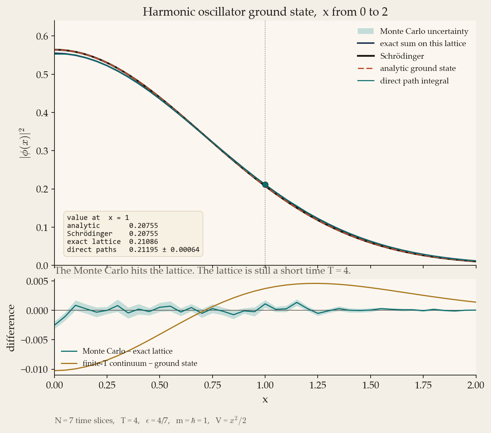
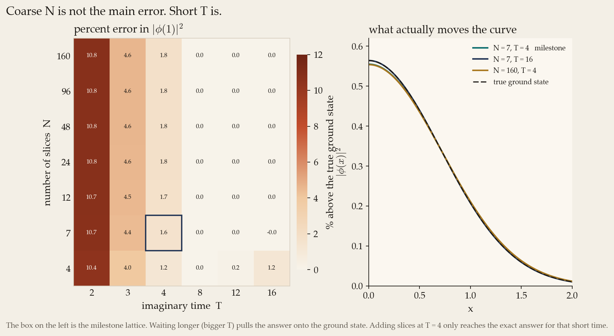
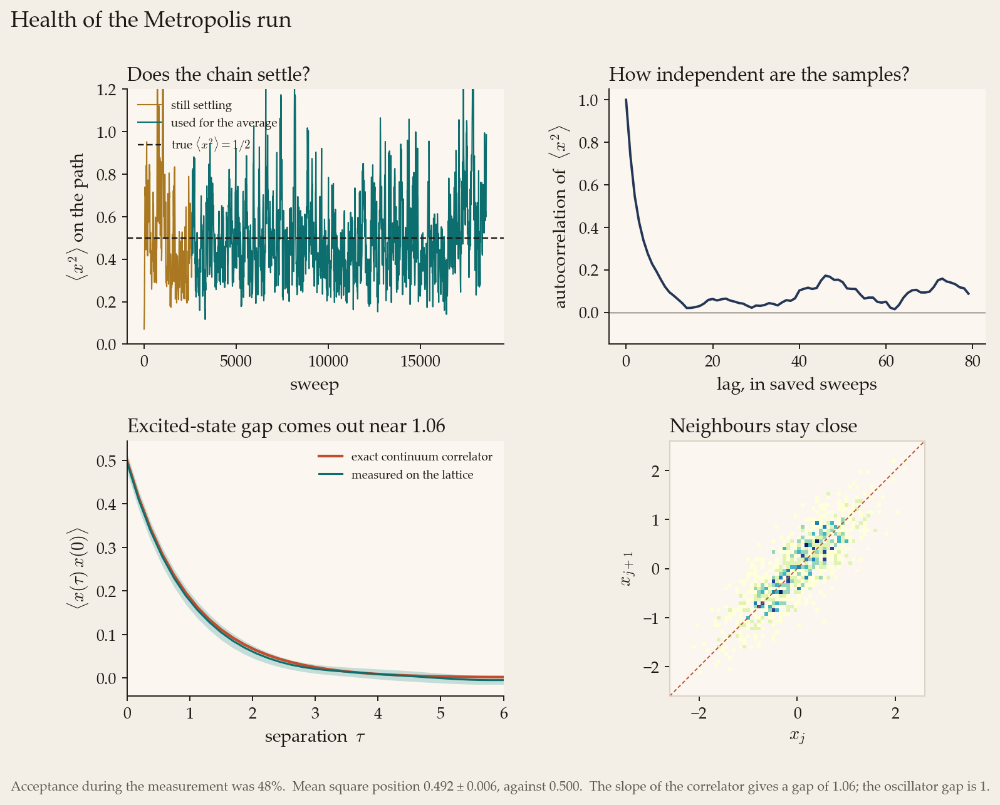
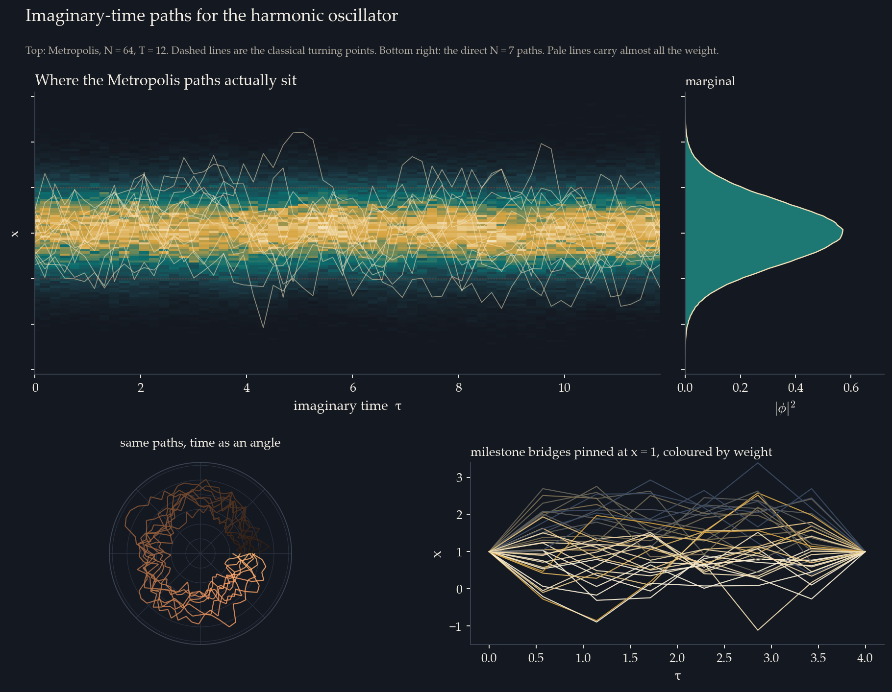
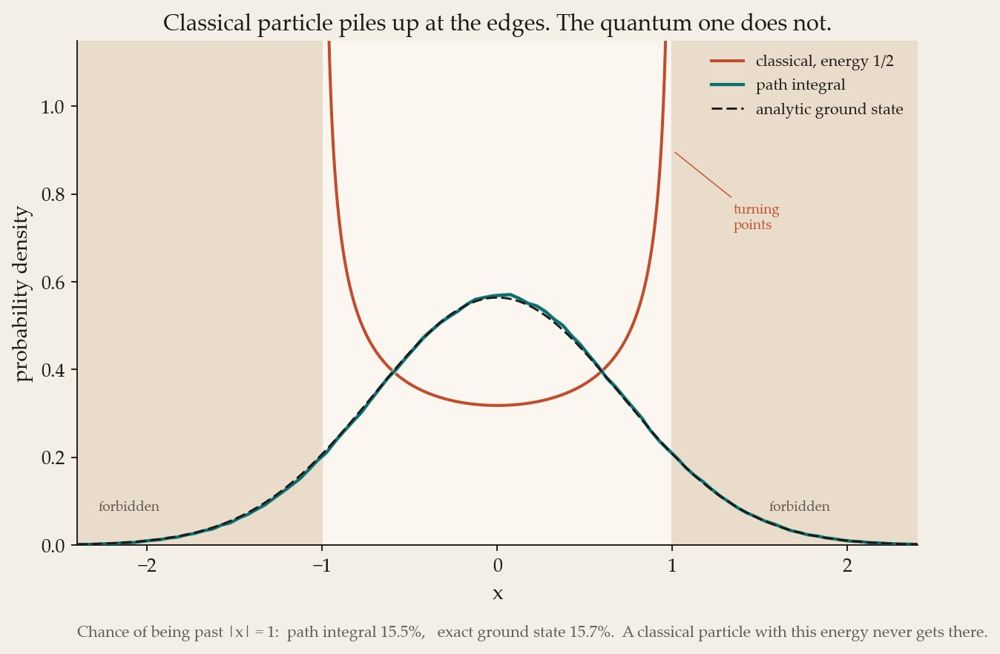
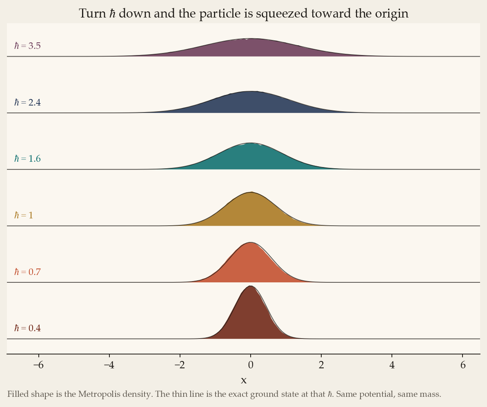
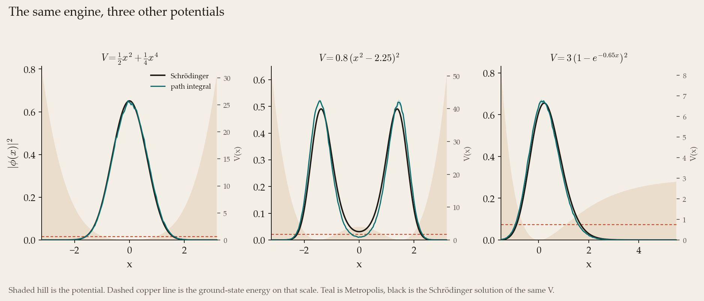

# Feynman path integral engine

Third-year computing project, chapter 14. A Euclidean path integral for one quantum particle, written so that each step can be checked against a number you can compute by hand. The milestone is the harmonic oscillator on the lattice $N = 7$, $T = 4$. The same library then runs a Metropolis chain, a Schrödinger solver, a window you can drag, and a histogram at up to a million slices.

The marks write-up, with the figures and the quoted errors, is [`WRITEUP.md`](WRITEUP.md). The short note on the tunnel splitting is [`THEORY.md`](THEORY.md). This file is the walk-through: the physics, then the algorithms, then the optimisations, then how to run it.

Units throughout are $m = 1$ and $\hbar = 1$ unless a section says otherwise, and the milestone potential is

$$V(x) = \frac12 x^2.$$

---

## 1. Run it

From this directory, with MinGW `g++` and Python (`numpy`, `matplotlib`):

```powershell
.\build.ps1 suite
```

That builds both programs, runs the long suite into `data/`, and redraws `figures/`.

Or in two steps:

```powershell
g++ -O3 -std=c++17 -pthread -I cpp -o build/feynman.exe cpp/main.cpp
.\build\feynman.exe suite data
python python/plot_all.py
```

The window:

```powershell
.\build\PathIntegral.exe
```

`libwinpthread-1.dll` has to sit next to that exe. `build.ps1` copies it. Keys `1`–`9` change page. The $N$ slider runs from 4 to $10^6$. Up to 48 the curve follows the slider. Above 48, **Run** writes `data/histogram.csv` and draws the histogram.

Rebuilding the window needs raylib 5.5 at `third_party/raylib` (not stored in this repo) and a static `libraylib.a`:

```powershell
g++ -O3 -std=c++17 -mwindows -I cpp -I third_party/raylib/src cpp/studio.cpp third_party/raylib/src/libraylib.a -lopengl32 -lgdi32 -lwinmm -static-libgcc -static-libstdc++ "-Wl,-Bstatic" -lwinpthread "-Wl,-Bdynamic" -o build/PathIntegral.exe
```

`build\feynman.exe selftest` checks the oscillator energy, the bridge variance, and that the direct Monte Carlo matches the exact lattice sum.

---

## 2. What the calculation is, one step at a time

### 2.1 Real time oscillates

Feynman’s rule is that the amplitude to go from $a$ to $b$ is a sum over every path $x(t)$, each weighted by a phase

$$e^{i S[x]/\hbar}, \qquad S[x] = \int L\,dt = \int \left(\frac{m}{2}\dot x^2 - V(x)\right) dt.$$

Paths near the classical path have almost the same $S$, so their phases line up. Wild paths point in every direction and cancel. A computer cannot add those phases stably: the integrand spins around the unit circle.

### 2.2 Imaginary time turns the phase into a weight

Set $\tau = -it$. The phase becomes a decaying weight $e^{-S_E/\hbar}$. With $m = \hbar = 1$,

$$S_E[x] = \int_0^T \left(\frac12 \dot x^2 + V(x)\right) d\tau.$$

Large action is now small weight, which a sampler can handle. What you lose is real-time motion. What you gain, if $T$ is long, is the ground state. An energy eigenstate contributes a factor $e^{-E_n T}$. The excited states die relative to the ground state as $e^{-(E_n - E_0)T}$.

### 2.3 The lattice the brief asks for

Chop the imaginary-time interval into $N$ slices of width

$$\varepsilon = T / N.$$

A path is the list $x_0, x_1, \ldots, x_N$. The action on one link, with the potential at the midpoint (the prescription in the brief), is

$$\varepsilon E_j = \frac{m}{2\varepsilon \hbar}(x_j - x_{j-1})^2 + \frac{\varepsilon}{\hbar} V\left(\frac{x_j + x_{j-1}}{2}\right).$$

The weight of the whole path is

$$w = \exp\left(-\sum_{j=1}^{N} \varepsilon E_j\right).$$

The milestone lattice is $N = 7$, $T = 4$, so $\varepsilon = 4/7 \approx 0.571$. Both ends are fixed at the $x$ you are asking about. That leaves 6 interior positions to integrate. ($T = 3$ appears in the brief as the other time; it is a column of the convergence grid, and the reported lattice is $T = 4$.)

### 2.4 The density is a closed path

The ground-state density is the propagator that starts and ends at the same point, normalised:

$$|\phi(x)|^2 = \frac{G(x,-iT;\, x, 0)}{\displaystyle\int G(x,-iT;\, x, 0)\, dx}.$$

On a periodic chain the histogram of the bead positions is the same object. Average enough closed paths and the histogram is $|\phi|^2$.

### 2.5 The number everyone can check

The oscillator ground state is known exactly:

$$|\phi(x)|^2 = \frac{e^{-x^2}}{\sqrt{\pi}}, \qquad |\phi(1)|^2 = \frac{e^{-1}}{\sqrt{\pi}} = 0.20755.$$

Also $\langle x^2\rangle = 1/2$, $E_0 = 1/2$, and the gap $E_1 - E_0 = 1$.

The path integral on $N = 7$, $T = 4$ does not land on $0.20755$. The number it lands on is the right answer for that lattice. Section 5 says why, with the table.

---

## 3. Four ways to get the same density

Each method answers a slightly different question. They agree when they are asked the same question.

### 3.1 Direct Monte Carlo: sample the kinetic piece exactly

Throwing the interior points uniformly into a box is a waste. Almost every path has a huge kinetic action and a weight of zero.

A free particle on this lattice is a Brownian bridge. With the two ends fixed, each interior point is Gaussian. Its mean is the straight line between the ends, and the variance of a free step is

$$\sigma^2 = \varepsilon \hbar / m,$$

scaled by how much of the bridge is still to come. That distribution is exactly the kinetic part of $e^{-\varepsilon E}$. The only thing left to average is the potential weight

$$w = \exp\left(-\sum_j \frac{\varepsilon}{\hbar} V(\text{midpoint}_j)\right).$$

The mean of $w$, as a function of the pinned position $x$, is proportional to $G(x,x)$. Divide by the trapezium integral over $x$ so the density integrates to 1.

Errors come from splitting the samples into batches and taking the scatter of the batch means. That scatter includes the uncertainty in the normalisation. The implementation is `direct_ground_density` in `cpp/feynman/direct.hpp`. The sum over $x$ is split across threads.

This is importance sampling. It is the same integral as weighting paths by $e^{-\varepsilon E}$. The kinetic measure is exact, so the random numbers only have to resolve $V$.

### 3.2 Exact lattice sum, oscillator only

For $V = \frac12 x^2$ the whole integral is Gaussian. The quadratic form on the $N-1$ interior points has a dense covariance. A Cholesky factor (`lattice_alpha` in `exact_ho.hpp`) gives the exact lattice density

$$|\phi(x)|^2 = \sqrt{\frac{\alpha}{\pi}}\, e^{-\alpha x^2}$$

with no random numbers. At $N = 7$, $T = 4$,

$$\alpha \approx 0.96786, \qquad |\phi(1)|^2 = 0.21086.$$

The factorisation is $O(N^3)$ and stores an $(N-1)\times(N-1)$ matrix. It is the check on the Monte Carlo for small $N$. It is never called at a million slices.

### 3.3 Metropolis: keep paths with the right probability

The bridge sum rebuilds a path at every $x$. Once $N$ is large, most of those paths are rejected by $V$. Metropolis–Hastings only keeps paths with probability proportional to their weight, and then a plain histogram is enough.

One sweep, as in the brief:

1. A path is $N$ positions on a ring. The end joins the start, which is the closed propagator.
2. Pick a site and propose a symmetric shift uniform in $[-\delta, \delta]$.
3. $\Delta S$ is the change in the action on the two links that touch that site. Every other link is untouched, so the update is $O(1)$.
4. Keep the shift if $\Delta S \le 0$. Otherwise keep it with probability $e^{-\Delta S}$.
5. Walk through every site. That is one sweep.
6. Throw away a burn-in, then histogram the positions.

$\delta$ is tuned on a short pilot until the acceptance sits near 45%, then frozen. Changing $\delta$ during the measurement would break detailed balance. The code is `metropolis_ground_state` in `metropolis.hpp`.

The production chain used for the quoted long-run numbers is $N = 64$, $T = 12$, four chains, 16 000 sweeps after the burn-in. Acceptance came out at 48%.

### 3.4 Schrödinger, the matrix check

The comparison curve solves

$$-\frac{\hbar^2}{2m}\frac{d^2\psi}{dx^2} + V\psi = E\psi$$

on a grid. The Hamiltonian is tridiagonal. The lowest eigenvalue is found by a Sturm count and bisection. The bracket starts near $\min V$, a little below it, so the search does not lock onto a high mode of the discrete Laplacian. The eigenvector is inverse iteration. For the first excited state the start vector is a sine with one node; a constant start vector stays in the even subspace and misses the odd state.

On the oscillator this returns $E_0 = 0.499999$ and $|\phi(1)|^2 = 0.20755$, the analytic answer to five figures. When the path integral disagrees with this curve, the path integral is carrying the lattice error. The code is `solve_schrodinger` in `schrodinger.hpp`.

---

## 4. The milestone number



| method | $\lvert\phi(1)\rvert^2$ |
|---|---|
| analytic ground state | 0.20755 |
| Schrödinger, this grid | 0.20755 |
| exact sum on $N=7$, $T=4$ | 0.21086 |
| direct Monte Carlo, same lattice | $0.21195 \pm 0.00064$ |
| continuum propagator at the same $T=4$ | 0.21125 |

**The milestone number is $0.2120 \pm 0.0006$.** That is the direct Monte Carlo at $N = 7$, $T = 4$. It agrees with the exact lattice sum. The root-mean-square difference over the curve is $0.0003$, inside the error band on the figure.

The window’s short live chain is a different, smaller sample. The numbers in this table come from `build\feynman.exe suite`.

---

## 5. Why 0.212 is above 0.208

Two effects, and they move the answer in different directions.

**Finite $T$.** At imaginary time $T$ the oscillator density is still a Gaussian, with a narrower exponent:

$$|\phi_T(x)|^2 = \sqrt{\frac{\tanh(T/2)}{\pi}}\, \exp\!\big(-x^2 \tanh(T/2)\big).$$

At $T = 4$, $\tanh 2 \approx 0.964$, and $|\phi(1)|^2 = 0.21125$. That is already 1.8% above the ground state. The gap is 1, so the first excited state is down by $e^{-4} \approx 0.018$. Small, and still visible.

Making the lattice finer at fixed $T = 4$ walks toward $0.21125$. It walks toward the ground state $0.20755$ only if $T$ grows as well.



Read down the $T = 4$ column and the error stays near 1.6% however many slices you add. Read along the $N = 7$ row and by $T = 8$ the error has gone. The teal box is the milestone.

On the small lattice, Metropolis gives $|\phi(1)|^2 = 0.2110 \pm 0.0054$, which covers the exact lattice value $0.21086$. On the long lattice $N = 64$, $T = 12$,

$$|\phi(1)|^2 = 0.2087 \pm 0.0057, \qquad \langle x^2\rangle = 0.492 \pm 0.006,$$

against $0.20755$ and $1/2$.

---

## 6. What else a path is carrying

The histogram is the ground-state density. The same path has three more readings. They are derived in [`THEORY.md`](THEORY.md) and drawn on the Gap and Diagnostics pages.

**The correlator.** For the oscillator

$$\langle x(\tau) x(0)\rangle = \frac12 \frac{\cosh\big(T/2 - \tau\big)}{\sinh(T/2)}.$$

The slope of $\log C(\tau)$ is a rough estimator of the gap $E_1 - E_0$. On the oscillator the points follow the cosh, and a fit gives about $1.06$ against the true gap $1$.

**The energy on a link.** After subtracting the divergence of a short time step,

$$E = \frac{1}{2\varepsilon} - \left\langle \frac{m (\Delta x)^2}{2 \hbar \varepsilon^2} \right\rangle + \left\langle \frac{V}{\hbar} \right\rangle.$$

On a coarse lattice this is the lattice energy. A long oscillator chain read $0.43 \pm 0.01$ against the Schrödinger value $0.50$. It moves toward $0.50$ as $\varepsilon$ shrinks. It is a check, and it is a different number from the eigenvalue.

**Crossings.** An oscillator path crosses zero many times: about $10.6$ times per path on the long chain. A path sat in one side of a double well hardly ever does.



The chain is settled before the average starts. The autocorrelation of $\langle x^2\rangle$ has fallen off after about 15 saved sweeps, which is why the error is a batch error. Neighbouring beads stay close to the diagonal: the kinetic term is a spring.



The bright band is where the chain spends its time. Its marginal is $|\phi|^2$. The lower-right panel is the milestone itself: every bridge pinned at $x = 1$. The pale paths carry almost all the weight.

---

## 7. Optimisations, and why each one is there

The numerical headers in `cpp/feynman/` have no comments. This section is the commentary.

| choice | where | what it saves |
|---|---|---|
| Brownian bridge | `direct.hpp` | The kinetic action is sampled exactly. The Monte Carlo only averages $e^{-\varepsilon V/\hbar}$. A uniform draw of the interior points would return weights of zero. |
| Threads across $x$ | `direct.hpp` | Each pinned position is an independent integral. The suite uses 4 threads. |
| Cholesky, small $N$ only | `exact_ho.hpp` | The oscillator lattice sum is exact and has no statistical error. The matrix is $O(N^3)$, so the window calls it only for $N \le 48$. |
| Local Metropolis | `metropolis.hpp` | $\Delta S$ uses the two links that touch the moved site. One sweep is $O(N)$, with a handful of potential evaluations per site. |
| Pilot, then freeze $\delta$ | `metropolis.hpp` | The step is tuned until acceptance is near 45%, then held fixed, so the measurement chain obeys detailed balance. |
| Batch means | everywhere | Sweeps are correlated. The error is the scatter of batch averages, with the usual factor $1/\sqrt{B(B-1)}$. |
| Correlator on one chain | `metropolis.hpp` | The worldline and the correlator are the expensive diagnostics. They are accumulated on chain 0. The density uses every chain. |
| xoshiro256\*\* | `rng.hpp` | A small stateless-looking generator with a splitmix seed. `normal()` is Box–Muller with one spare, so Gaussians come in pairs. |
| Sturm count from $\min V$ | `schrodinger.hpp` | The bracket starts just below the bottom of the potential. Starting on the diagonal scale $1/(\Delta x)^2$ finds a high mode of the Laplacian (the first version returned $E \approx 1464$). |
| Sine start for level 1 | `schrodinger.hpp` | Inverse iteration from a constant vector stays even and misses the odd state. A sine with the right number of nodes finds $E_1$. On the oscillator, $E_1 = 1.500$. |
| Histogram one chain | the design note | The direct sum rebuilds a bridge at every $x$. A Metropolis histogram builds the whole curve from one ensemble. A short solve and a short chain are about a millisecond; the direct sum is several times longer. |
| Fourier draw at large $N$ | `histogram.hpp` | A local step of size $\sqrt{\varepsilon}$ cannot move the centre of a million-slice path in any reasonable number of sweeps. The centre needs $O(N/T)$ local sweeps. Section 8 is that algorithm. |
| Subsample the beads | `histogram.hpp` | Modes above $k \approx 48$ add almost nothing to $\langle x^2\rangle$. The histogram is accumulated on about 4096 sites of the path. $N$ still sets $\varepsilon$ and the mode frequencies. A million slices comes back in well under a second. |
| Worker thread in the window | `studio.cpp` | Raylib stays on the main thread. The chain is published by swapping a `shared_ptr` under a mutex. Dragging $N$ while a short sample is in flight drops that sample if $N$ has moved, so a stale curve is never drawn as the new one. |

---

## 8. A million slices

Drag $N$ on a log slider from 4 to $1\,000\,000$. Press **Run** above 48.

`large_histogram` in `histogram.hpp` does the following.

**1.** Write the path in Fourier modes on the ring,

$$x_j = a_0 + \sum_{k=1}^{k_{\max}} \big( A_k \cos \omega_k j + B_k \sin \omega_k j \big), \qquad \omega_k = 2\pi k / N,$$

with $k_{\max} = 48$ (or $N/2$ when that is smaller).

**2.** The kinetic action of mode $k$ is quadratic, $\alpha_k A^2$, with

$$\alpha_k^{\mathrm{kin}} = \frac{m N^2}{T \hbar}\sin^2\!\left(\frac{\pi k}{N}\right).$$

Sample $A_k$ and $B_k$ as independent Gaussians of variance $1/(2\alpha_k)$. That is the exact free measure for those modes.

**3.** For the oscillator, add the potential stiffness of a cosine,

$$\alpha_k^{\mathrm{pot}} = \frac{T a}{4\hbar}$$

(here $a = 1$), and draw the zero mode exactly,

$$\langle a_0^2\rangle = \frac{\hbar}{a T}.$$

At $T = 4$ this is $1/4$. The sum of the mode variances is near the bead variance $1/2$.

**4.** For any other potential the modes stay free, the double well is started half at $+b$ and half at $-b$, and a global shift $\delta$ is accepted with the potential action only. The kinetic piece is unchanged by a rigid shift. A local Metropolis step is not used: it cannot mix $N = 10^6$ at fixed $T$.

**5.** Bin the subsampled sites. Density is counts over (samples $\times \Delta x$). Four batches give the error column.

**6.** Write `data/histogram.csv`: a preamble $N, T, m, \hbar$, the potential, the sweep count, then `x, count, density, error`.

The Milestone page draws those bars with the Schrödinger curve and, for the oscillator, the analytic Gaussian. The value in the side panel is this histogram interpolated at $x = 1$. It is a different run from the milestone quote $0.2120 \pm 0.0006$.

---

## 9. Classical tail, ℏ, and other potentials

A classical particle with energy $1/2$ in $V = x^2/2$ is stuck between the turning points $x = \pm 1$. It moves slowly at the ends, so the dwell-time density piles up there:

$$\rho_{\mathrm{cl}}(x) = \frac{1}{\pi\sqrt{1 - x^2}}, \qquad |x| < 1.$$



About 15.5% of the quantum density sits in the classically forbidden region. The exact ground state has $\mathrm{erfc}(1) = 15.7\%$ outside $|x| = 1$.



The chance of being outside a **fixed** wall at $|x| = 1$ is

$$P(|X| > 1) = \mathrm{erfc}\!\left(\frac{1}{\sqrt{\hbar}}\right).$$

| $\hbar$ | $P(\lvert x\rvert > 1)$ |
|---|---|
| 0.40 | 0.0253 |
| 0.70 | 0.0910 |
| 1.00 | 0.1573 |
| 1.60 | 0.2636 |
| 2.40 | 0.3613 |
| 3.50 | 0.4497 |

The Metropolis scan sits on that curve. If the wall is instead the turning point of that same $\hbar$, the probability is $\mathrm{erfc}(1) = 0.1573$ at every $\hbar$. The Gaussian and the turning point scale together. Sending $\hbar \to 0$ empties a fixed wall. It leaves the tail past the turning point alone.



| potential | $V(x)$ | what the spectrum says |
|---|---|---|
| anharmonic | $\tfrac12 x^2 + \tfrac14 x^4$ | $E_0 = 0.621$, gap $1.405$ |
| double well | $0.8(x^2 - 2.25)^2$ | minima at $\pm 1.5$, barrier $\approx 4.05$, $E_0 = 1.731$, $E_1 = 1.798$, gap $0.067$ |
| Morse | $3(1 - e^{-0.65 x})^2$ | $E_0 = 0.746$, gap $1.173$ |
| quartic | $\tfrac14 x^4$ | $E_0 = 0.421$, gap $1.089$ |

The oscillator gap is $1$. Anharmonic, Morse and quartic have no closed ground state; the gaps above are the second eigenvalue of the same solver.

---

## 10. The result to take further: the double well

Full prose is in [`THEORY.md`](THEORY.md). The short version:

The spectrum sees the tunnel splitting. At $\hbar = 1$ the gap is $0.067$. From $\hbar = 2.2$ down to $\hbar = 0.45$ that gap falls from $1.52$ to $5\times 10^{-5}$, about five orders of magnitude. That curve is two eigenvalues of the Hamiltonian the paths are sampling. No WKB formula was assumed.

A local Metropolis chain on the same potential crosses zero $0.09$ times per path. Its correlator drops a little on the first time step, which is the fast motion inside one well, and then sits flat. A log-slope fit of that flat line does not return $0.067$.

The histogram still shows two peaks, because half the chains are started in each well. That is a mixture of two trapped ensembles. It is a different object from one path that tunnels.

Density in the barrier is also a different object from the splitting. At $\hbar = 1$, about 16% of the ground state sits between the inner turning points, and the gap is $0.067$. At $\hbar = 0.45$ the barrier share is still about 10%, and the gap is $5\times 10^{-5}$.

The missing update is a kink: propose flipping a whole stretch of the path from one well to the other, accept or reject it with the same action, and fit the gap again. If that fit comes back near $0.067$, the path integral and the spectrum agree on the thing a local move cannot reach. That change belongs in `metropolis.hpp`.

---

## 11. Where the code is

```
cpp/feynman/feynman.hpp    one include for a new simulation
cpp/feynman/potential.hpp  ho, anharmonic, double well, Morse, quartic
cpp/feynman/action.hpp     one link, the energy estimator, sign crossings
cpp/feynman/direct.hpp     Brownian-bridge density
cpp/feynman/exact_ho.hpp   Cholesky lattice sum
cpp/feynman/metropolis.hpp the chain
cpp/feynman/schrodinger.hpp Sturm count and inverse iteration
cpp/feynman/histogram.hpp  million-slice histogram and the CSV
cpp/feynman/research.hpp   tails and the barrier fraction
cpp/feynman/rng.hpp        xoshiro256** and Box–Muller
cpp/main.cpp               selftest, suite, run
cpp/studio.cpp             the window
python/plot_all.py         redraws figures/ from data/
app/explorer.py            older browser front end on `feynman run`
First_attempt/main.py      the first histogram sketch
```

A new simulation should include the header and call the library. Copying the window is the expensive way to ask a new question.

```cpp
#include "feynman/feynman.hpp"
using namespace feynman;

Potential V = parse_potential("ho");
Spectrum sp = solve_schrodinger(V, 1.0, 1.0, -10, 10, 801);
// sp.energy, sp.psi2

MetroConfig c;
c.pot = V;
c.N = 32;
c.T = 8;
c.sweeps = 4000;
MetroResult R = metropolis_ground_state(c);
// R.psi2, R.psi2_at_1, R.mean_x2
```

`feynman run` on the console clamps $N$ to the range the local chain is built for. The million-slice path is the window, or `large_histogram` directly.

---

## 12. What is deliberately left open

The kink move is not in the library yet. The large-$N$ histogram for a non-quadratic potential is a free-mode draw plus a global shift, which gets the roughness and the centre right and does not fully equilibrate the lowest modes against a complicated $V$. The oscillator case includes the quadratic stiffness, and that is the histogram checked against $e^{-x^2}/\sqrt{\pi}$.

The quoted suite numbers live in [`WRITEUP.md`](WRITEUP.md) and in `data/`. Regenerating them is `.\build.ps1 suite`.
