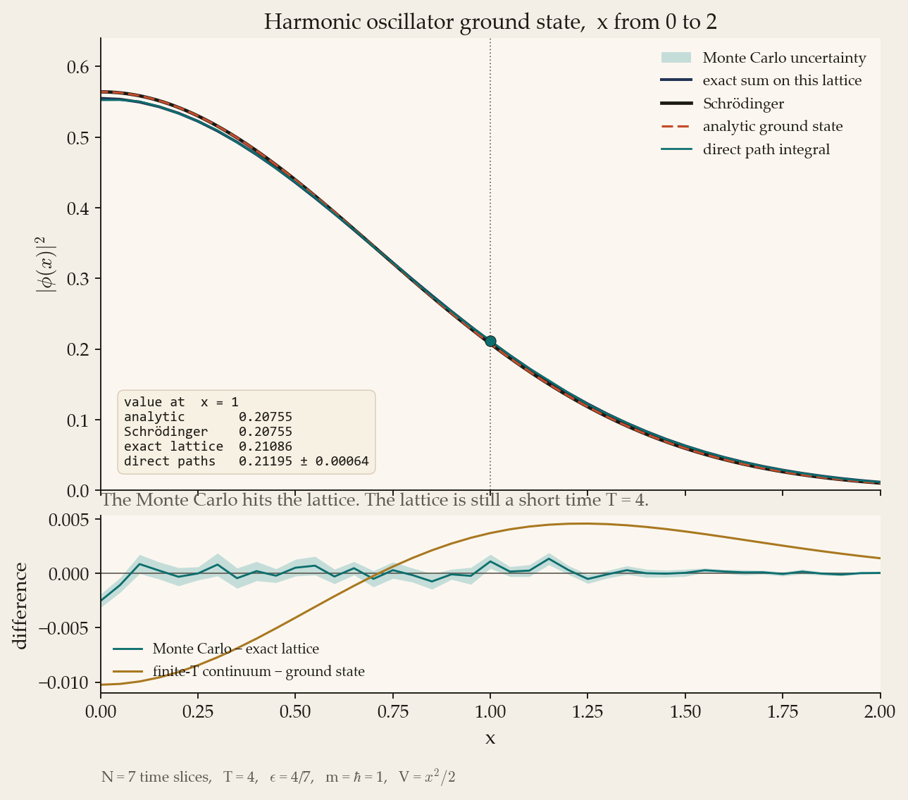
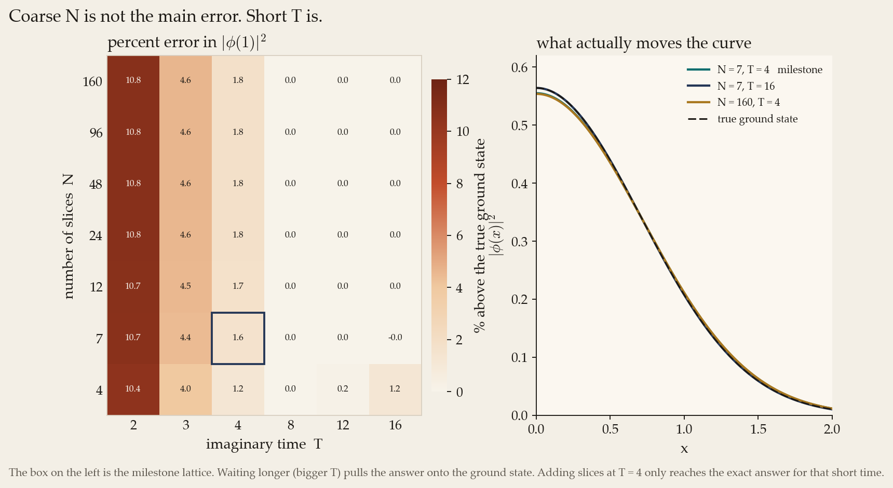
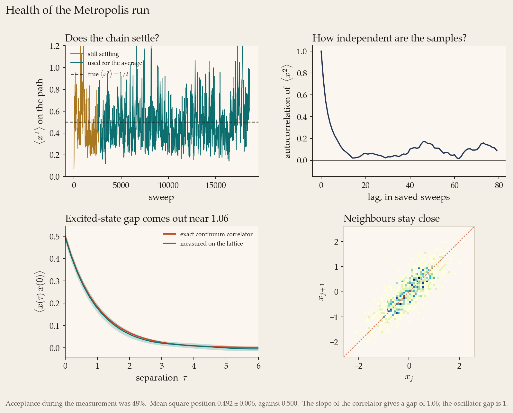
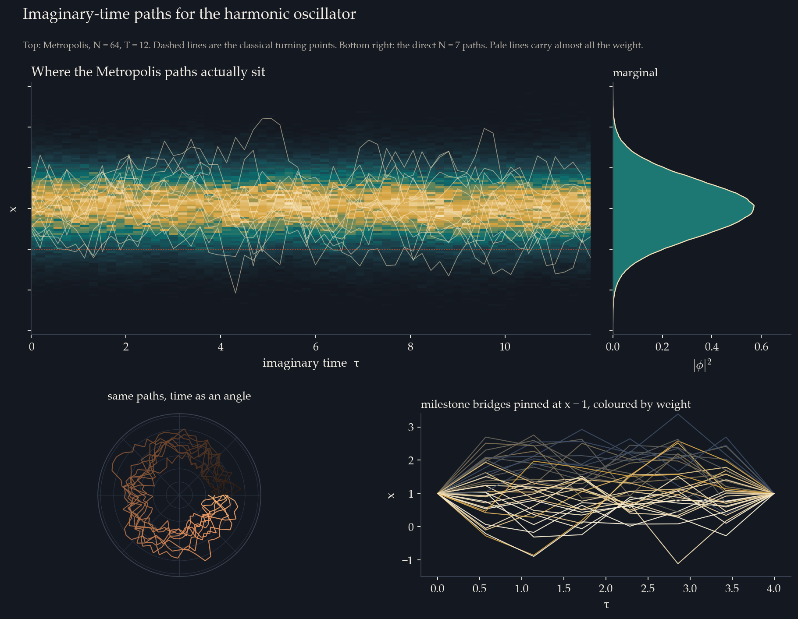
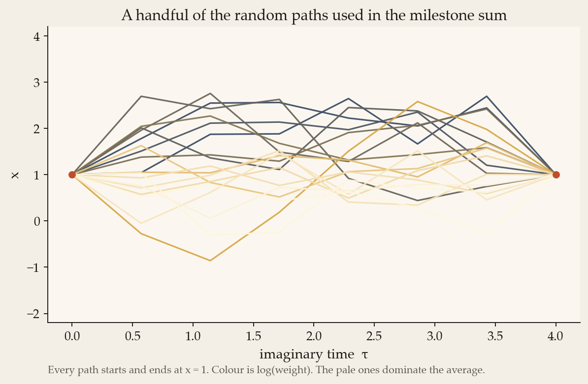
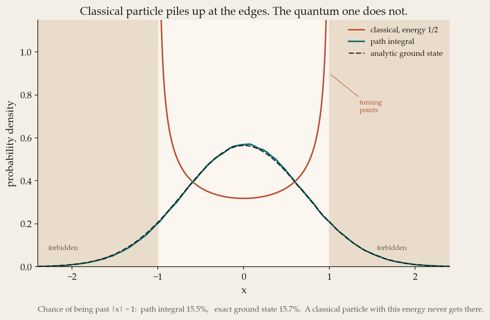
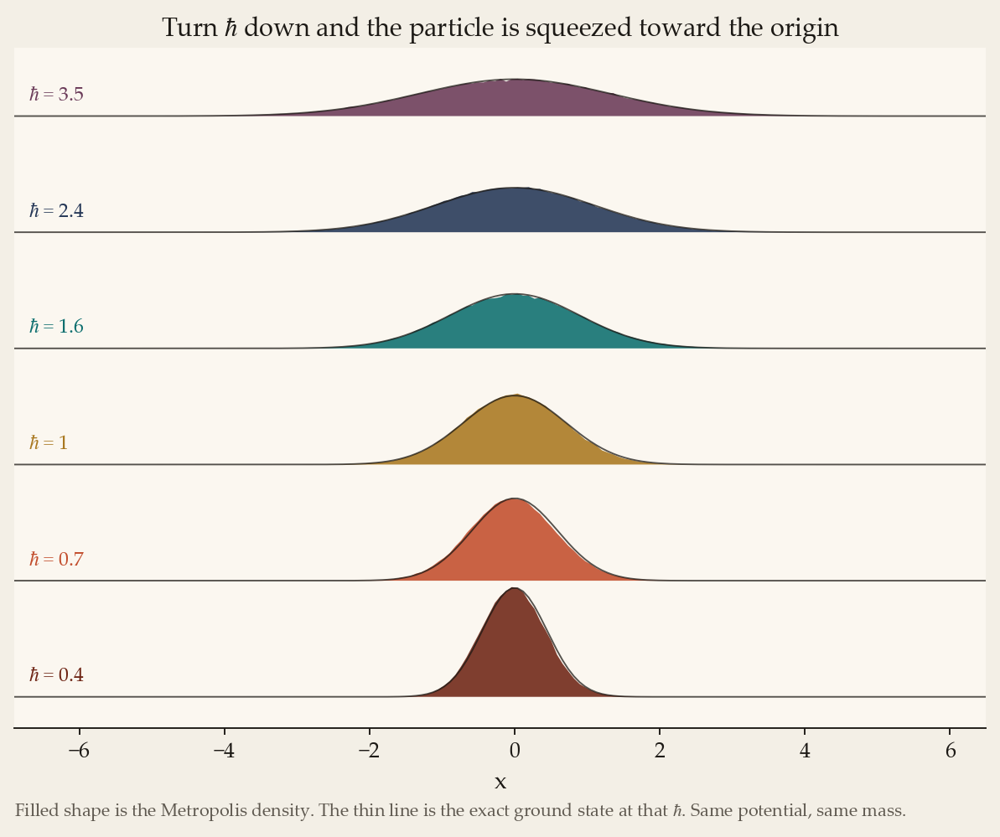
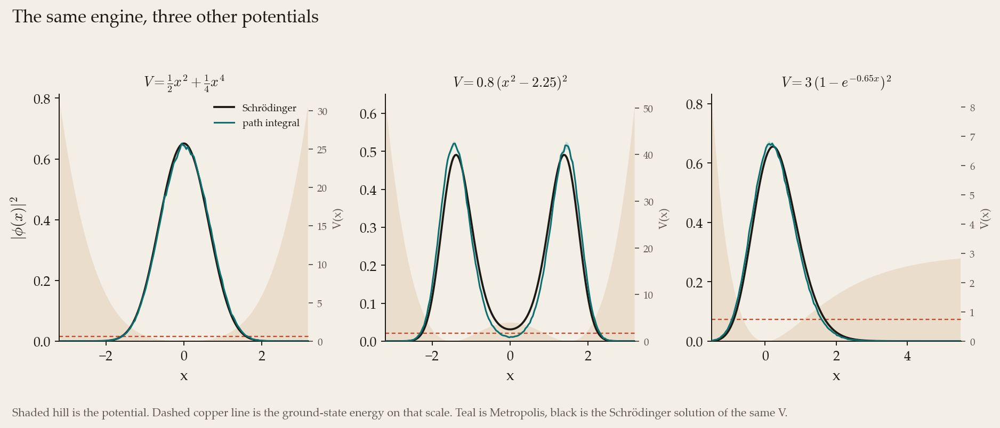

# Feynman path integral

The milestone is the ground state of a harmonic oscillator, worked out two ways. One way is Feynman's path integral on a small lattice. The other is the Schrödinger equation. The number the project asks for is the probability density at $x = 1$.

I use units where the mass and $\hbar$ are both 1, and

$$V(x) = \frac12 x^2.$$

The true ground state is known,

$$|\phi(x)|^2 = \frac{e^{-x^2}}{\sqrt{\pi}},$$

so at $x = 1$

$$|\phi(1)|^2 = 0.20755.$$

The path integral on the milestone lattice does not land exactly on that number. It lands on $0.2120 \pm 0.0006$. That is the right answer for the lattice I was asked to use. The rest of this note is why, and what I changed so the same code can go further.

## The idea

In ordinary quantum mechanics you solve for energy eigenstates. Feynman's version says something more physical. To get from $a$ to $b$, the particle tries every path, and each path contributes a phase $e^{iS/\hbar}$. $S$ is the classical action, the integral of the Lagrangian along that path. Paths near the classical one have nearly the same action, so their phases line up. Wild paths point in all directions and cancel.

That sum is horrible to compute, because the phases oscillate. The trick used here is to switch to imaginary time, $\tau = -it$. The oscillating phase turns into a plain decaying weight $e^{-S}$. Paths with a large action get suppressed instead of cancelled, which a computer can handle. The price is that you are no longer watching the particle move in real time. What you get, if you wait long enough, is the ground state.

On a lattice the weight of one path is $e^{-\epsilon E}$, with

$$E = \sum_{j=1}^{N} \left[ \frac{m}{2}\left(\frac{x_j - x_{j-1}}{\epsilon}\right)^2 + V\left(\frac{x_j + x_{j-1}}{2}\right) \right].$$

$N$ is the number of time slices, $\epsilon = T/N$ is the step, and the potential is evaluated halfway between neighbouring points, which is what the project brief writes down. A path is just the list of positions $x_0, x_1, \ldots, x_N$.

The ground-state density is the propagator that starts and ends at the same place, normalised:

$$|\phi(x)|^2 = \frac{G(x,-iT;x,0)}{\int G(x,-iT;x,0)\,dx}.$$

Long $T$ kills the excited states, because they decay as $e^{-(E_n-E_0)T}$. For this oscillator the gap is 1, so at $T = 4$ the first excited state is down by a factor $e^{-4} \approx 0.018$. Small, but not nothing. That leftover is visible in the results.

## Design of the program

The brief asks for the design before the results: the functions, what they take and return, the inputs and outputs, and the data structures. This is that design. The same text is on the Design page of `PathIntegral.exe`.

A path is one array of positions, `x[0] … x[N]`. The histogram is one array of counts, one bin per position. Errors are another array, the scatter of the same histogram built on separate batches of the run. Nothing fancier than that.

```
ε = T / N

function link_action(left, right, ε, mass, hbar, V) -> number
    midpoint = (left + right) / 2
    kinetic = mass * (right - left)^2 / (2 * ε * hbar)
    return kinetic + ε * V(midpoint) / hbar

function direct_ground_density(N, T, V, x_grid, samples) -> density, value_at_1, error
    for each x in x_grid:
        for each sample:
            path = brownian_bridge from x back to x
            weight = exp( - sum of ε * V(midpoint) along the path )
        G(x) = average weight
    density = G / integral of G
    return density, density at x = 1, batch error

function metropolis_ground_state(N, T, V, sweeps) -> histogram, paths, correlator
    path = N positions on a ring
    repeat sweeps:
        for each site:
            propose a small shift
            dS = change in link_action on the two links that touch the site
            keep the shift if dS <= 0, otherwise keep it with probability exp(-dS)
    histogram of the positions is |φ(x)|^2

function solve_schrodinger(V, mass, hbar, grid) -> wavefunction, density, energy
    build the tridiagonal Hamiltonian
    lowest eigenvalue by bisection
    ground-state vector by inverse iteration

INPUT   N, T, mass, hbar, the potential, the x grid, how many samples
OUTPUT  |φ(x)|^2 from the path integral and from Schrödinger, and the value at x = 1
```

`link_action` is in `cpp/feynman/action.hpp`. The direct sum is `direct_ground_density` in `direct.hpp`. The Metropolis update is `metropolis_ground_state` in `metropolis.hpp`. The matrix solution is `solve_schrodinger` in `schrodinger.hpp`. A new potential is a new case in `potential.hpp`. The window in `PathIntegral.exe` already lists the potentials it knows, so adding one there is the extension, not a rewrite.

## Milestone lattice

The brief says to use $N = 7$ points spread over $T = 4$, with $\epsilon = T/N$. I took that literally:

- 7 slices, so 6 interior positions to integrate,
- $\epsilon = 4/7 \approx 0.571$,
- both ends fixed at the $x$ I am asking about.

(The brief also mentions $T = 3$ in the sentence about the classical period. The line that actually defines the lattice is $N = 7$, $T = 4$, $\epsilon = T/N$, so that is the run I report.)

## How the direct sum works

Doing the integral by throwing the interior points uniformly into a box is a waste. Almost every path has a huge kinetic piece and a weight of zero. I sample the kinetic piece exactly and Monte Carlo only the potential.

A free particle on this lattice is a Brownian bridge. Given the two ends, each interior point is a Gaussian whose mean is the straight interpolation toward the far end, and whose variance is

$$\sigma^2 = \epsilon\,\hbar/m$$

times the fraction of the bridge still to go. That distribution is exactly the kinetic part of $e^{-\epsilon E}$. Each sampled path is then given the potential weight

$$w = \exp\left(-\sum_j \epsilon\, V(\text{midpoint}_j)/\hbar\right).$$

The average of $w$, as a function of the pinned position $x$, is proportional to $G(x,x)$. I divide by the trapezium integral over $x$ so the density integrates to 1. Errors come from splitting the samples into batches and taking the scatter of those batches, which includes the uncertainty from the normalisation.

For the harmonic oscillator the whole integral is Gaussian, so I can also do it with a Cholesky decomposition and no random numbers at all. That exact lattice answer is the check on the Monte Carlo. If the random paths are right, they sit on that curve, and the difference from the Schrödinger ground state is then a property of $N$ and $T$, not a bug.

The code for this lives in `cpp/feynman/direct.hpp` (`direct_ground_density`, `bridge_potential_weight`) and `cpp/feynman/exact_ho.hpp` (`lattice_alpha`). A path is a `vector<double>`. The histogram and the batch means are the other structures. Inputs are $N$, $T$, mass, $\hbar$, the potential, the $x$ grid and the sample count. The output is a CSV of $|\phi(x)|^2$ plus the value at $x = 1$.

## Schrödinger, for the comparison

The other curve is a straight numerical solution of

$$-\frac{\hbar^2}{2m}\frac{d^2\psi}{dx^2} + V\psi = E\psi$$

on a grid from $-10$ to $10$ with 4001 interior points. The Hamiltonian is tridiagonal. I find the lowest eigenvalue with a Sturm count and bisection, then the ground-state vector by inverse iteration. The residual on that vector is about $4 \times 10^{-12}$.

It gives

$$E_0 = 0.499999, \qquad |\phi(1)|^2 = 0.20755,$$

which is the analytic answer to five figures. So when the path integral disagrees with this curve, the path integral is the one carrying the lattice error.

## The value at $x = 1$



| method | $\lvert\phi(1)\rvert^2$ |
|---|---|
| analytic ground state | 0.20755 |
| Schrödinger, this grid | 0.20755 |
| exact sum on the $N=7$, $T=4$ lattice | 0.21086 |
| direct Monte Carlo, same lattice | $0.21195 \pm 0.00064$ |
| continuum propagator at the same $T=4$, before any lattice | 0.21125 |

The Monte Carlo and the exact lattice sum agree. Over the whole curve the root-mean-square difference is $0.0003$, inside the error band drawn on the figure. The dot on the plot is the Monte Carlo value at $x = 1$.

**The milestone number I am reporting is $0.2120 \pm 0.0006$.**

That is $|\phi(1)|^2$ from the path integral at $N = 7$, $T = 4$. The Schrödinger value at the same point is $0.20755$.

## Why they are not identical

Two separate things move the answer, and they move it in different directions.

At finite $T$ the density is not yet the ground state. For this oscillator the exact continuum result at imaginary time $T$ is still a Gaussian, but narrower in the exponent:

$$|\phi_T(x)|^2 = \sqrt{\frac{\tanh(T/2)}{\pi}}\, e^{-x^2 \tanh(T/2)}.$$

At $T = 4$, $\tanh 2 \approx 0.964$, and $|\phi(1)|^2$ comes out at 0.21125. That is already 1.8% above the ground state. Making the lattice finer at fixed $T = 4$ walks you toward 0.21125. It does not walk you toward 0.20755.

To reach the ground state you have to wait longer. The grid below is the percent by which the exact lattice value sits above the true ground state.



Read down the $T = 4$ column and the error stays near 1.6% no matter how many slices you add. Read along the $N = 7$ row and by $T = 8$ the error has gone. The boxed cell is the milestone. The bottom panel of the first figure is the same story on the shape of the curve: the teal trace (Monte Carlo minus the exact lattice) rattles around zero, while the gold trace is the finite-$T$ shift, which is smooth and bigger.

So the milestone program is doing the integral it was asked to do. The analytic ground state is a slightly different question, "what do you get if $T$ is long and $\epsilon$ is small", and that needs the next algorithm.

## Metropolis

Summing random bridges is fine for $N = 7$. It gets painful as soon as $N$ is large, because you are still sampling paths that the potential will throw away. The Metropolis algorithm only keeps paths with a probability proportional to their weight, and then a plain average is enough. No weights at the end.

One update, as in the brief:

1. Start from a path, a list of $x_j$ on a ring (the end joins the start, which is the same object as a closed propagator).
2. Pick a site and shift it by a random amount in $[-\delta, \delta]$.
3. Compute $\Delta S$, the change in $\epsilon E$ from the two links that touch that site.
4. Keep the shift if $\Delta S \le 0$. Otherwise keep it with probability $e^{-\Delta S}$.
5. Walk through every site. That is one sweep.
6. Throw away the early sweeps, then average.

I tune $\delta$ on a short pilot so the acceptance sits near 45%, then I freeze it. Changing $\delta$ during the measurement would break the balance of the chain. The production run is $N = 64$, $T = 12$, four independent chains, 16 000 sweeps each after the burn-in. Acceptance came out at 48%.

On the same little lattice as the milestone, Metropolis gives

$$|\phi(1)|^2 = 0.2110 \pm 0.0054,$$

which covers the exact lattice value 0.21086. On the long lattice,

$$|\phi(1)|^2 = 0.2087 \pm 0.0057, \qquad \langle x^2\rangle = 0.492 \pm 0.006.$$

The ground state has $\langle x^2\rangle = 1/2$ and $|\phi(1)|^2 = 0.20755$. Both measurements agree with that, with errors of a few percent. The direct method on $N = 7$ was tighter on its own lattice; Metropolis is the one that can actually reach the ground state.



The chain is settled before I start averaging. The autocorrelation of $\langle x^2\rangle$ has fallen off after about 15 saved sweeps, which is why the error bars come from batch means rather than from pretending every sweep is a fresh draw. Neighbouring points on a path stay close to the diagonal: the kinetic term is a spring, and the Metropolis move respects it.

The correlator $\langle x(\tau) x(0)\rangle$ is the way into excited states. For this oscillator it should be

$$\langle x(\tau)x(0)\rangle = \frac12 \frac{\cosh(\omega(T/2-\tau))}{\sinh(\omega T/2)}$$

with $\omega = 1$. The measured points follow that curve. A rough slope on the log of the correlator gives a gap of 1.06, against the true gap of 1. Good enough to see that the first excited state is sitting where it should, which is the thing I want this observable for later.

## What the paths look like



The heatmap is the whole ensemble: a bright band around $x = 0$, fading by the time you reach the classical turning points at $|x| = 1$ (the dashed lines). The marginal of that band is $|\phi(x)|^2$. The ring is the same paths with $\tau$ drawn as an angle, just so a closed path looks closed.

The lower right is the milestone itself. Every bridge is pinned at $x = 1$ at both ends. The pale paths carry almost all the weight. The dark ones wander off and barely count. That picture is why the reweighting, and later Metropolis, matters: a handful of paths dominate the sum.



## Classical against quantum

A classical particle with the ground-state energy $E = 1/2$ is stuck between the turning points $x = \pm 1$. It also moves slowly at the ends, so the time-averaged density piles up there and diverges:

$$\rho_{\mathrm{cl}}(x) = \frac{1}{\pi\sqrt{1-x^2}}, \qquad |x| < 1.$$



The quantum density is a Gaussian through the middle, and 15.5% of it sits in the forbidden region. The exact ground state has 15.7% out there. That tail is the first thing you lose if you send $\hbar$ to zero.



Small $\hbar$ squeezes the particle toward the origin. The Metropolis histogram tracks the exact curve at every value I tried, from 0.4 up to 3.5. This is the knob I want for the classical limit later in the year. The potential and the updater do not change. Only $\hbar$ in the action does.

## Other potentials

The oscillator is only there because I know the answer. The library takes the potential as an argument, so the same Metropolis and the same Schrödinger solver run on anything I can write down as $V(x)$.



- Anharmonic, $V = x^2/2 + x^4/4$. Stiffer than the oscillator, so the density is narrower. Schrödinger energy $E_0 = 0.621$. The path integral sits on top of it.
- Double well, $V = 0.8\,(x^2 - 2.25)^2$. Minima at $x = \pm 1.5$, barrier of height about 4 at the origin. The ground energy is $E_0 = 1.73$, under the barrier, and both methods show the two peaks. Half the chains start in the left well and half in the right, because a local update is slow to tunnel and I do not want a run that only saw one side.
- Morse, $V = 3(1 - e^{-0.65 x})^2$. This one is not symmetric. The density leans into the soft side, and again the two methods agree.

## Where things live

```
cpp/feynman/     the library (potentials, action, direct sum, Metropolis, Schrödinger)
cpp/main.cpp     command line: selftest, suite, run
cpp/studio.cpp   the window, build\PathIntegral.exe
python/          one script per figure
app/explorer.py  the older browser page, still there
data/            the CSV the plots read
figures/         the plots in this note
```

Rebuild and regenerate everything with

```
g++ -O3 -std=c++17 -pthread -I cpp -o build/feynman.exe cpp/main.cpp
build\feynman.exe suite data
python python/plot_all.py
```

`build\feynman.exe selftest` checks the Sturm count, the oscillator energy, the bridge variance, and that the direct Monte Carlo matches the exact lattice sum.

The program I actually open is `build\PathIntegral.exe`. Double click it. It is the same library, drawn in a window: the milestone curve from 0 to 2, the value at $x = 1$, the convergence grid (including $T = 3$), the paths, the classical comparison, the $\hbar$ scan and the other potentials. The algorithm for the page you are on is written down the right hand side. Quartic is in the potential list as the example of adding one more: a case in `potential.hpp` and a line in `kPotOrder`. A new page is an entry in `kPages`. The numbers quoted above come from the longer `suite` run. The window uses a shorter run so it opens quickly, and it still lands on the same lattice value.

## What I want to do with this for the rest of the year

The milestone is a check that the integral is right. The thing I actually want is a tool I can point at a potential and trust.

The library is already split so that $V(x)$ is not baked into the updater. The explorer is a thin front end on `feynman run`: pick a potential, set $N$, $T$, mass and $\hbar$, and it draws the path-integral density against the Schrödinger solution, plus a few of the paths. That is the program I will keep extending, rather than writing a new script every time the question changes.

The questions I want to take to the supervisor, in the order I would actually do them:

1. **Classical limit.** The $\hbar$ plot is a first pass. Next is to put the classical dwell-time density on the same axes for a potential that is not the oscillator, and watch the forbidden-region probability die as $\hbar$ drops. I want a clean plot of that probability against $\hbar$, with an error bar, for the double well as well as the oscillator.

2. **Tunnelling, seen on a path.** The double-well histogram already has two peaks. A histogram throws away the interesting object, which is a single path that sits in one well and then jumps. I will record the paths and look for those jumps, and see how the time between jumps depends on the barrier. That is the instanton the textbooks draw, taken out of the code rather than assumed.

3. **Whether I believe my errors.** The autocorrelation plot shows the sweeps are not independent. I will compare one long chain with several shorter ones on the double well, where mixing is the actual problem, and only quote an error if the chains agree with each other. If a local shift cannot cross the barrier in a reasonable time, the next move to add is a shift of the whole path, not a fancier potential.

4. **The gap.** I now compute the second eigenvalue as well as the ground state. On the oscillator the path correlator sees that gap. On the double well it does not: the splitting is real, and a local update almost never crosses the barrier, so the correlator stays flat. That comparison is written up in `THEORY.md`, and it is the piece I want to take further.

5. **Only then, a second dimension.** Path integrals earn their place on problems that are awkward as a Schrödinger equation. A 2D potential is the honest step up. Lattice QCD is the reason this formalism exists, and I have read enough of Lepage to see the shape of it, but a 2D quantum mechanics problem is the project I can finish and defend.

The standard I want by the end of the year is simple. Same plots as the milestone, for a potential where I do not know the answer in advance, with an error bar I can explain, and the explorer so the comparison can be rerun live.

## Research

The brief asks for one investigation with the program, not a tour of every suggestion. I did two, both checked against something I can compute exactly. They are on the Research page.

**The classical tail depends on which wall you hold still.** For the oscillator the chance of being outside $|x| = 1$ is $\mathrm{erfc}(1/\sqrt{\hbar})$. At $\hbar = 1$ that is 15.7%, which is the number in the classical figure. At $\hbar = 0.4$ it is 2.5%. At $\hbar = 3.5$ it is 45%. The Metropolis scan sits on that curve.

If instead the wall is the classical turning point of that same $\hbar$, the chance is $\mathrm{erfc}(1) = 15.7\%$ at every $\hbar$. The Gaussian widens and the turning point moves out together. Sending $\hbar$ to zero only empties a fixed forbidden region. It does not change the tail past the turning point.

**A gap with no formula, and a warning about the barrier.** Anharmonic, Morse and quartic have no closed ground state. The second eigenvalue gives gaps 1.405, 1.173 and 1.089, against 1 for the oscillator. On the double well the gap at $\hbar = 1$ is 0.067, and 16% of the ground state sits between the inner turning points. At $\hbar = 0.45$ that barrier share is still 10%, but the gap has fallen to $5 \times 10^{-5}$. Density in the barrier is not the tunnel splitting. `THEORY.md` is that comparison in full.

## The library, and the next runs

The window is a front end. The functions are a library in `cpp/feynman`, brought in by one header:

```
#include "feynman/feynman.hpp"
```

`link_action` is one slice of the weight. `direct_ground_density` is the bridge sum. `metropolis_ground_state` is the chain. `solve_schrodinger` is the matrix check, including the excited state. `lattice_alpha` is the exact oscillator integral. `ho_outside_fixed` is the tail above.

The documents are `WRITEUP.md` (this note), `THEORY.md` (the splitting), and `README.md` (the build). The Library page in the window is the same list.

The Research page times a short job. The Schrödinger solve and a short chain come back in about a millisecond. The direct sum takes several times longer, because it rebuilds a bridge at every $x$. A histogram chain does the whole curve at once, so that is the call a new simulation should make. The gallery's long chains are a different budget. On the double well those extra sweeps still do not cross the barrier, which is why the next change inside the library is a kink move, not a longer loop. New questions should be a new file that includes the header, not another copy of the window.
